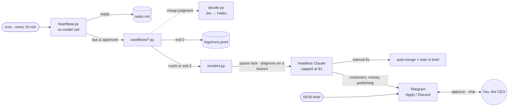

<div align="center">

<h1>
<picture>
  <source media="(prefers-color-scheme: dark)" srcset="brand/steerable-logo-white.png">
  
</picture>
</h1>

**You're the CEO. The system is everything else.**

An operating system for running a company with [Claude Code](https://claude.com/claude-code) as your COO.
Plain programs do the routine work for $0. AI is called only where judgment is needed.

[](LICENSE)
[](https://www.python.org/)
[](#requirements)
[](https://claude.com/claude-code)

[Quick start](#quick-start) · [Steerable Cloud](#steerable-cloud) · [How it works](#how-it-works) · [Commands](#commands) · [Workflows](#writing-a-workflow) · [Security](#security-model) · [Configuration](#configuration)

</div>

---

## Why Steerable

Agent-first systems give every role to an AI agent that thinks on every tick. That's expensive, hard to audit, and different every time it runs.

Steerable turns that around:

| | Agent-first systems | Steerable |
|---|---|---|
| **Who does the work** | AI agents, on every heartbeat | Scripts and cron. Same result every time, $0 per run |
| **Where AI runs** | Everywhere | Only at judgment points: classify, diagnose, draft, chat |
| **Visibility** | Agent reasoning | A script in git, a log line, a row on the mission board |
| **Cost control** | Hope | A per-call cap, a monthly budget, and a ledger of every paid call |
| **Risky actions** | Agent discretion | Money, customers, publishing and deletion always wait for your tap |

You get company structure (goals, missions, a heartbeat, budgets, approvals, an audit trail) at a fraction of the token cost.

## Quick start

### With Docker (recommended)

```bash
curl -fsSL https://raw.githubusercontent.com/archit3ckt/steerable/master/get.sh | sh
```

It asks for your business's name, a passphrase for your dashboard, and your [Anthropic API key](https://console.anthropic.com) (or skip it and sign in with your Claude account), then starts two containers: your COO (the engine, with Claude Code, Python and a browser inside) and your **dashboard** at http://localhost:3100. Everything your COO knows and does lives on a Docker volume, so restarts and updates keep it.

Open the dashboard, and your COO starts by getting to know your business, one question at a time. It ends with **one** first routine to take off your plate, with a plan and what it saves you. Nothing gets built until you approve it.

```bash
docker compose pull && docker compose up -d     # update (in ~/steerable-docker; your data stays)
docker compose logs -f engine                  # watch your COO work
docker compose exec -it engine claude          # talk to it in the terminal, or /login to sign in
```

Settings live in `~/steerable-docker/.env` (see [.env.example](.env.example)): Telegram, email alerts, the monthly budget, and whether the dashboard is open to your network. From a clone, `sh get.sh --build` builds the images yourself.

**Website logins:** for sites without an app (a supplier portal, a booking system), Connections → "Log in to a website" opens the site in a browser on your server, shown live in the dashboard. You log in yourself; Steerable keeps only the logged-in session (in `.cache/sites/`, which no AI can read), and approved routines get a browser that's already logged in. When a routine needs one, its decision says "Log in to …" with a button.

**Telegram** (optional): on the dashboard's Connections page, paste a bot token from [@BotFather](https://t.me/BotFather) and open the link it shows. Your brief, anything urgent and your decisions then come to Telegram too, and you can chat with your COO there.

**Connect your services:** the dashboard's **Connections** page lists services with an official MCP server you can sign in to with one click (Notion, Airtable, Linear, Jira, monday.com, ClickUp, Close, Intercom, Calendly, PayPal, Dropbox, Klaviyo, Canva, Wix, Zapier, and Apify and Firecrawl for reading websites), Stripe with a restricted key, and a box for any other MCP server by its address. Signed in with your Claude account instead of an API key? The connectors you add at [claude.ai](https://claude.ai/settings/connectors) (Gmail, Google Calendar, Slack, HubSpot...) work too, with nothing to set up. Your COO looks things up in them on its own; anything that would send, create or change something waits in your Decisions (allow once, always allow, or don't). Some services only accept sign-ins that come back to `http://localhost`, so connect from the machine running Steerable.

**Moving a company:** "Download your company" in the dashboard gives you one file with everything your COO knows. Start a new install from it with `sh get.sh --import company.tar.gz`, or bring it to Steerable Cloud when you sign up.

**Connect to Steerable Cloud** (optional): keep running it yourself, but get AI included in a plan instead of your own key, connected accounts like Gmail and Calendar through Steerable's verified apps, and **Steerable playbooks**: a library of proven know-how on running a business (cash flow, pricing, getting paid, customers, hiring, planning) that your COO works from. Choose "On my own server" when you sign up, then copy `STEERABLE_URL` and `STEERABLE_KEY` from its "Your server" page into `.env` and run `docker compose up -d`.

### On your machine

```bash
curl -fsSL https://raw.githubusercontent.com/archit3ckt/steerable/master/install.sh | bash
steerable setup
```

`setup` asks for a company name, builds the project (Python env, Playwright, git), asks for your API keys (each one can be skipped), and offers to start the background services. Then talk to your COO:

```bash
cd ~/companies/<your-company>
steerable
```

Say **"start onboarding"**. The [dashboard](dashboard/README.md) works here too: start `scripts/agent_api.py` and run it with Node.

> [!TIP]
> Something not working? Run `steerable doctor`. It checks your system, project, keys and services, and prints the fix for every problem it finds.

## Steerable Cloud

Don't want to run it yourself? Steerable Cloud runs this same engine for you, one private container per business, with AI included in the plan, connected accounts (Gmail, Calendar, Stripe, Notion and more) through verified apps, Steerable playbooks (proven business know-how your COO works from), your team, and backups. Your company folder is the same either way, so you can move in either direction: export it from the cloud and run it here, or bring a self-hosted company to the cloud.

## How it works



1. **The heartbeat** runs from cron every 15 minutes. It reads `tasks.md` with plain Python and runs only the workflows that are due, approved and not paused. Idle ticks cost nothing.
2. **Workflows** are ordinary Python scripts. When they need a judgment call, they use `decide()`, which costs a fraction of a cent and caches repeat questions.
3. **When something breaks,** the incident engine pauses the task, then starts headless Claude to find the root cause and commit a fix on a `fix/<id>` branch in a separate worktree. Internal fixes merge on their own. Anything that touches customers, money or publishing waits for your tap.
4. **You hear from the COO** in one daily brief at 09:00, with Approve/Reject buttons. Urgent pings are capped at two a day and never sent during quiet hours. You can also message the COO in plain text at any time.

### Your COO

The generated `CLAUDE.md` makes Claude the COO and you the CEO. Claude:

- **Owns the outcome:** systems work, workflows move their goals, the schedule holds, and the company stays healthy.
- **Follows an incident playbook** for every problem: detect, contain, diagnose, prepare, escalate, learn.
- **Builds every workflow to a standard:** a goal and a metric, quality checks, watchers, logging and cost tracking.
- **Validates before building:** no revenue workflow without evidence of demand, using a pass/fail bar set in advance.
- **Protects your attention:** short messages, one point at a time, and only big decisions, risks or opportunities, each with options and a recommendation.
- **Gets better over time:** a nightly review turns your corrections into [skills](#skills-the-coo-learns), with a cheap gate first so quiet days cost about $0.

## What's in a company

| Component | What it does |
|---|---|
| **`tasks.md`** | The task board: due dates, recurring tasks, approvals. Plain text you can edit. |
| **Heartbeat** | Cron, every 15 min. Checks for due work with no model call and runs workflow scripts. |
| **`decide.py`** | Cheap yes/no, classify, route and prioritize calls. Uses [Jev by TypeSafe](https://docs.typesafe.ai) (a decision model about 25× cheaper than Haiku) with Haiku as the fallback, or Haiku alone. |
| **Budget cap** | Every paid call is logged to `logs/spend.jsonl`, and runs stop at your monthly limit. |
| **Incident engine** | Failures wake Claude, which diagnoses them and prepares a fix on a branch. |
| **Telegram partner** | Daily brief, one-tap buttons, `/status`, `/brief`, and free-text chat with your COO. |
| **Alerts** | Email and Telegram. At most 2 pings a day, none in quiet hours, one email per issue per day. |
| **Mission board** | `ops.db` (SQLite): goals → missions → activity log. No server. Your COO can mirror it to Sheets, Airtable or Monday. |
| **`memory/`** | Plain-file memory you can read and edit: company, processes, decisions, ideas. |
| **Skills** | `.claude/skills/`: how to do each kind of task for *you*, written and curated by the COO. |
| **Browser** | Playwright with Chromium, so the COO can work on the web. |
| **Routine builder** | `scripts/builder.py`: when you approve a routine that doesn't exist yet, the COO builds it in a separate git branch, tests it in dry-run mode, and only switches it on once it works. |
| **Dashboard** | `dashboard/`: an optional web app for you. Today's brief, decisions with one-tap choices, the timeline, routines and to-dos, goals, and chat with your COO, on your phone or computer, behind a passphrase. See [dashboard/README.md](dashboard/README.md). |
| **Agent API** | `scripts/agent_api.py`: the HTTP API the dashboard (and the hosted version, Steerable Cloud) uses. Shows decisions, the timeline, routines, goals and chat in plain words, and acts through the same code paths as Telegram. Standard library only. |

Business data (customers, orders) stays in your own tools. `ops.db` holds operations only.

## Commands

| Command | |
|---|---|
| `steerable` | Chat with your COO (opens Claude Code in the project) |
| `steerable setup [NAME] [--dir PATH]` | Create a new company, guided |
| `steerable doctor` | Find anything that's broken, with the fix |
| `steerable status [--days N]` | Heartbeat, runs, spend, tasks |
| `steerable tasks` | Open tasks and approvals |
| `steerable approve N` · `reject N` | Decide on a waiting task |
| `steerable incidents [ID] [apply\|discard\|close] [--all]` | What broke, what the COO found, and its fix |
| `steerable logs [-n N] [-f] [-q]` | Run log with costs (`-f` follows, `-q` hides idle ticks) |
| `steerable run [--dry-run]` | Run the heartbeat once now |
| `steerable brief` | Preview today's brief |
| `steerable board` | Goals, missions and their status |
| `steerable config [list\|get\|set] [KEY] [VALUE]` | Show or change settings in `.env` (secrets are masked) |
| `steerable workflow NAME` | Start a new workflow from the template |
| `steerable start` · `stop` | Background services (cron, Telegram bridge) |
| `steerable update` · `version` | Update the kit, print its version |

Commands work inside a company folder or any folder below it. Anywhere else, they use the company you created last. `-C PATH` picks another one.

## Writing a workflow

Your COO usually writes workflows for you, but they're plain Python and easy to write by hand.

```bash
steerable workflow weekly_report     # creates workflows/weekly_report.py from the template
.venv/bin/python workflows/weekly_report.py
```

Every workflow has three slots and follows one exit-code contract:

```python
def run(task: str) -> list[dict]:
    """Do the work with plain code. Call budget.check() before any paid call."""

def quality_problems(rows: list[dict]) -> list[str]:
    """Is the result actually right, not just produced?"""

def watch(rows: list[dict]) -> None:
    """Detect this workflow's own failure modes. Contain first, then open_incident()."""
```

| Exit code | Meaning | What the heartbeat does |
|---|---|---|
| `0` | Success | Logs it, and ticks off one-off tasks |
| `2` | Ran, but a quality check failed | Pauses the task and opens a *quality* incident |
| anything else | Crash | Pauses the task and opens a *crash* incident |

Schedule it with one line in `tasks.md`:

```
- [ ] Send the weekly report (goal: retention)  @workflow:weekly_report  every:weekly  needs:approval
```

| Tag | Meaning |
|---|---|
| `@workflow:<name>` | Runs `workflows/<name>.py`. Tasks without it are for you, or for Claude in a session. |
| `due:YYYY-MM-DD` | Skipped until this date |
| `every:daily\|weekly` | Recurring. Stays open after a successful run. |
| `needs:approval` | Waits until you approve it (Telegram button or `steerable approve`) |

### Cheap judgment with `decide()`

```python
from decide import decide

d = decide("Which team handles this?",
           {"billing": "Charges and refunds", "support": "Bugs and how-to questions"},
           context=email_text)
d.choice, d.confidence, d.backend
```

### Model routing

| Work | Uses |
|---|---|
| Is there work? Is it due? Parsing, fetching, formatting | Plain Python, no model |
| Yes/no, classify, route, prioritize | `decide.py` (Jev, then Haiku 4.5) |
| Drafting, summarizing, moderate judgment | Sonnet 5.5 |
| Strategy, pricing, hard high-value reasoning | Opus 5.5 |

## Skills the COO learns

Skills are procedural memory: how to do a class of task *for this CEO*. Claude Code loads one only when its description matches the task at hand.

- **`scripts/learn.py`** runs nightly. It collects the day's conversations, incident diagnoses and rejected approvals, and asks `decide()` whether anything is worth learning. Only if the answer is yes does Sonnet update `.claude/skills/`. Each change is validated, committed to git as "COO", and mentioned in the brief. Bad changes are rolled back.
- **`scripts/curate_skills.py`** runs weekly and archives COO-created skills that haven't been used in 30 days. Skills you wrote, and skills you pin (`scripts/skills.py pin NAME`), are never touched. Archived skills stay in git.

## Security model

Steerable lets an AI act for your company, so it is built to keep that AI on a short leash.

- **Approvals are required** for anything that spends money, contacts customers, publishes, or deletes data. Drafts are fine. Sends are not.
- **Headless agents are sandboxed by permission rules.** None of them can read `.env` or `.cache`.
  - The **Telegram chat agent** works only inside the project. It can't edit `scripts/`, `workflows/` or `tasks.md`, so it can't create workflows or approve its own tasks. It can run only the project's scripts and read-only git commands.
  - The **incident fixer** writes only to its own git worktree and `drafts/`, so the live project is never touched until a fix is applied.
  - The **learning loop** writes only to `.claude/skills/` and has no shell.
- **Connected services ask before changing anything.** In the chat, tools that only read run; every other tool call goes to `scripts/approvals.py` (Claude Code's `--permission-prompt-tool`), which puts it in your Decisions and lets through only the exact call you allowed, or tools you chose to always allow (never ones that delete). Their sign-ins and keys stay in `.cache/tools/`, which no agent can read and the export leaves out.
- **Every AI call has a spending cap:** $0.50 per Telegram message, $1 per incident, $0.30 per learning run, plus the monthly budget across everything.
- **Secrets stay in `.env`** (mode `600`, gitignored), never in memory files or git. `steerable config` masks them.
- **Outside text is untrusted.** The COO's rules forbid passing web pages, form answers or emails to an agent with broad write access.
- **Everything is auditable:** `logs/runs.jsonl` (every run), `logs/spend.jsonl` (every paid call), git history (every change), and `ops.db` (every mission step).

## Configuration

Settings live in each company's `.env`. Change them with `steerable config set KEY VALUE`.

| Key | Default | Purpose |
|---|---|---|
| `ANTHROPIC_API_KEY` | none | Used by `decide()`, the incident fixer and the learning loop |
| `MONTHLY_BUDGET_USD` | `20` | Hard cap on paid API spend per month |
| `DECIDE_BACKEND` | `haiku` (`jev` when connected to Steerable) | `haiku`, `jev`, or `rules` (no model, keyword rules only) |
| `JEV_API_KEY` | none | Required when `DECIDE_BACKEND=jev` |
| `JEV_MIN_CONFIDENCE` | `0.6` | Below this, Jev hands the decision to Haiku |
| `JEV_ENDPOINT`, `JEV_MODEL` | `jev-latest` | Optional gateway and model pin |
| `TELEGRAM_BOT_TOKEN` | none | From [@BotFather](https://t.me/BotFather). Enables the brief, buttons and chat. Easier: paste it on the dashboard's Connections page. Either way, your chat is linked by a one-time link (`scripts/telegram.py link` in a terminal), so nobody else can claim the bot. |
| `SMTP_HOST`, `SMTP_PORT`, `SMTP_USER`, `SMTP_PASS`, `ALERT_TO` | none | Email alerts to yourself |
| `RESTIC_PASSWORD` | generated | Backup encryption password. Keep a copy in a password manager. |

## Requirements

**With Docker:** Docker Desktop (Mac, Windows) or Docker Engine with the Compose plugin (Linux). That's all: Python, Claude Code, Node and the browser are inside the images. About 2 GB of disk.

**On your machine:**

- **Linux or macOS** (on Windows, use WSL2)
- **Python 3.10+** with `venv`. On Debian/Ubuntu: `sudo apt install python3-venv`
- **git**
- **[Claude Code](https://claude.com/claude-code)**, the runtime for your COO
- **cron**, so the heartbeat and brief run on their own
- **systemd** (Linux) to run the Telegram bridge as a service. On macOS, run `scripts/bridge.py` yourself.

The installer puts the kit in `~/.steerable` and the `steerable` command in `~/.local/bin`. You can change these with `STEERABLE_HOME` and `STEERABLE_REPO`.

## Repository layout

```
steerable/
├── bin/steerable             the CLI (standard library only, no venv needed)
├── get.sh                   one-line installer with Docker (writes .env, starts the containers)
├── docker-compose.yml       the engine and the dashboard, self-hosted
├── install.sh               one-line installer without Docker
├── setup.sh                 builds a company from template/
├── sync_template.py         pulls improvements from a live company back into the kit
├── install_backup_tools.sh  installs restic and rclone with checksum verification
├── tests/                   end-to-end tests: python3 -m unittest discover -s tests
├── dashboard/               the owner's web dashboard (Next.js): run it yourself, or host it (@steerable/dashboard)
├── container/               the image Steerable Cloud runs per company (Dockerfile, entrypoint)
└── template/                what every new company starts from
    ├── CLAUDE.md            the COO's operating manual
    ├── tasks.md             the task board
    ├── memory/              company, processes, decisions, ideas
    ├── scripts/             the engine: heartbeat, decide, budget, incident, bridge, brief, agent_api…
    └── workflows/           _template.py, then one file per routine
```

## Improving the kit

When a live company improves its engine, pull the improvements back into the template:

```bash
python3 sync_template.py "../My Company"
git diff   # review, then commit
```

This copies scripts and rules and rebuilds `template/CLAUDE.md` with the company-specific sections blanked. It never copies company data such as memory, tasks, logs, `.env` or workflows.

`steerable update` updates the kit. New companies get the changes. Existing companies keep their own copy of the engine, so an update never changes a running company without you.

## Known limitations

- The Telegram bridge service needs systemd. On macOS, run it yourself or under `launchd`.
- Backups are yours when you run it yourself (Steerable Cloud does them for you). Everything lives in one Docker volume; copy it with your usual backup tool, or: `docker run --rm -v steerable_company:/company -v "$PWD":/out alpine tar czf /out/company-$(date +%F).tar.gz -C /company .` "Download your company" in the dashboard gives you the company's files too (not its secrets or sessions).
- Running the unattended parts as a separate low-privilege user is planned but not set up by default.

## Your responsibility

Steerable is a tool you run. Your COO acts in your name: the emails it sends, the sites and accounts it uses, the information it collects and the changes it makes are your actions, and you're responsible for them.

- Use it only with accounts, sites and data you have the right to use, and within those sites' and services' terms. Some sites forbid automated use and may limit or close your account for it.
- Follow the laws that apply to your business and to what your COO does for it: privacy and data protection (you're the one in charge of the information it handles), anti-spam and marketing rules, consumer, employment and tax law, and telling people they're dealing with AI where that's required.
- AI makes mistakes. Approve routines you're happy to see run unsupervised, check the timeline, and don't treat anything it says as legal, tax, financial or other professional advice.

Steerable comes with no warranty, and its authors aren't liable for how it's used (sections 15 and 16 of the [license](LICENSE)). Connected to Steerable Cloud, the [Steerable Terms](https://steerable.app/terms) apply too.

## License

[AGPL-3.0](LICENSE). You can use, change and self-host Steerable freely. If you run a modified version as a service for others, you must publish your changes under the same license.
