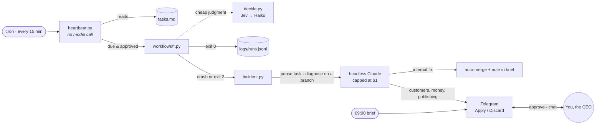

# How Steerable works

What's inside the engine, how routines run, and how to write one. Back to the [README](../README.md).

## Why Steerable

Agent-first systems give every role to an AI agent that thinks on every tick. That's expensive, hard to audit, and different every time it runs.

Steerable turns that around:

| | Agent-first systems | Steerable |
|---|---|---|
| **Who does the work** | AI agents, on every heartbeat | Scripts and cron. Same result every time, $0 per run |
| **Where AI runs** | Everywhere | Only at judgment points: classify, diagnose, draft, chat |
| **Visibility** | Agent reasoning | A script in git, a log line, a row on the mission board |
| **Cost control** | Hope | A per-call cap, a monthly budget, and a ledger of every paid call |
| **Risky actions** | Agent discretion | A new routine shows you a practice run first, then runs under watch until it has proven itself |

You get company structure (goals, missions, a heartbeat, budgets, approvals, an audit trail) at a fraction of the token cost.

## How it works



1. **The heartbeat** runs from cron every 15 minutes. It reads `tasks.md` with plain Python and runs only the workflows that are due, approved and not paused. Idle ticks cost nothing.
2. **Workflows** are ordinary Python scripts. When they need a judgment call, they use `decide()`, which costs a fraction of a cent and caches repeat questions.
3. **When something breaks,** the incident engine pauses the task, then starts headless Claude to find the root cause and commit a fix on a `fix/<id>` branch in a separate worktree. Internal fixes merge on their own. Anything that touches customers, money or publishing waits for your tap.
4. **You hear from the COO** in one daily brief at 09:00, with Approve/Reject buttons. Urgent pings are capped at two a day and never sent during quiet hours. You can also message the COO in plain text at any time.

### Your COO

The generated `CLAUDE.md` makes Claude the COO and you the CEO. Claude:

- **Owns the outcome:** systems work, workflows move their goals, the schedule holds, and the company stays healthy.
- **Follows an incident playbook** for every problem: detect, contain, diagnose, prepare, escalate, learn.
- **Builds every workflow to a standard:** a goal and a metric, quality checks, watchers, logging and cost tracking.
- **Validates before building:** no revenue workflow without evidence of demand, using a pass/fail bar set in advance.
- **Protects your attention:** short messages, one point at a time, and only big decisions, risks or opportunities, each with options and a recommendation.
- **Gets better over time:** a nightly review turns your corrections into [skills](#skills-the-coo-learns), with a cheap gate first so quiet days cost about $0.

## What's in a company

| Component | What it does |
|---|---|
| **`tasks.md`** | The task board: due dates, recurring tasks, approvals. Plain text you can edit. |
| **Heartbeat** | Cron, every 15 min. Checks for due work with no model call and runs workflow scripts. |
| **`decide.py`** | Cheap yes/no, classify, route and prioritize calls. Uses [Jev by TypeSafe](https://docs.typesafe.ai) (a decision model about 25× cheaper than Haiku) with Haiku as the fallback, or Haiku alone. |
| **Budget cap** | Every paid call is logged to `logs/spend.jsonl`, and runs stop at your monthly limit. |
| **Incident engine** | Failures wake Claude, which diagnoses them and prepares a fix on a branch. |
| **Telegram partner** | Daily brief, one-tap buttons, `/status`, `/brief`, and free-text chat with your COO. |
| **Alerts** | Email and Telegram. At most 2 pings a day, none in quiet hours, one email per issue per day. |
| **Mission board** | `ops.db` (SQLite): goals → missions → activity log. No server. Your COO can mirror it to Sheets, Airtable or Monday. |
| **`memory/`** | Plain-file memory you can read and edit: company, processes, decisions, ideas. |
| **Skills** | `.claude/skills/`: how to do each kind of task for *you*, written and curated by the COO. |
| **Browser** | Playwright with Chromium, so the COO can work on the web. |
| **Routine builder** | `scripts/builder.py`: when you approve a routine that doesn't exist yet, the COO builds it in a separate git branch, tests it in dry-run mode, and only switches it on once it works. Common routines start from tested ones in `scripts/catalog/` (see its README), so they're quicker and cheaper to set up. |
| **Dashboard** | `dashboard/`: an optional web app for you. Today's brief, decisions with one-tap choices, the timeline, routines and to-dos, goals, and chat with your COO, on your phone or computer, behind a passphrase. See [dashboard/README.md](../dashboard/README.md). |
| **Agent API** | `scripts/agent_api.py`: the HTTP API the dashboard (and the hosted version, Steerable Cloud) uses. Shows decisions, the timeline, routines, goals and chat in plain words, and acts through the same code paths as Telegram. Standard library only. |

Business data (customers, orders) stays in your own tools. `ops.db` holds operations only.

## Writing a workflow

Your COO usually writes workflows for you, but they're plain Python and easy to write by hand.

```bash
steerable workflow weekly_report     # creates workflows/weekly_report.py from the template
.venv/bin/python workflows/weekly_report.py
```

Every workflow has three slots and follows one exit-code contract:

```python
def run(task: str) -> list[dict]:
    """Do the work with plain code. Call budget.check() before any paid call."""

def quality_problems(rows: list[dict]) -> list[str]:
    """Is the result actually right, not just produced?"""

def watch(rows: list[dict]) -> None:
    """Detect this workflow's own failure modes. Contain first, then open_incident()."""
```

| Exit code | Meaning | What the heartbeat does |
|---|---|---|
| `0` | Success | Logs it, and ticks off one-off tasks |
| `2` | Ran, but a quality check failed | Pauses the task and opens a *quality* incident |
| anything else | Crash | Pauses the task and opens a *crash* incident |

Schedule it with one line in `tasks.md`:

```
- [ ] Send the weekly report (goal: retention)  @workflow:weekly_report  every:weekly  needs:approval
```

| Tag | Meaning |
|---|---|
| `@workflow:<name>` | Runs `workflows/<name>.py`. Tasks without it are for you, or for Claude in a session. |
| `due:YYYY-MM-DD` | Skipped until this date |
| `every:daily\|weekly` | Recurring. Stays open after a successful run. |
| `needs:approval` | Waits until you approve it (Telegram button or `steerable approve`) |

### Cheap judgment with `decide()`

```python
from decide import decide

d = decide("Which team handles this?",
           {"billing": "Charges and refunds", "support": "Bugs and how-to questions"},
           context=email_text)
d.choice, d.confidence, d.backend
```

### Model routing

| Work | Uses |
|---|---|
| Is there work? Is it due? Parsing, fetching, formatting | Plain Python, no model |
| Yes/no, classify, route, prioritize | `decide.py` (Jev, then Haiku 4.5) |
| Drafting, summarizing, moderate judgment | Sonnet 5.5 |
| Strategy, pricing, hard high-value reasoning | Opus 5.5 |

### Any model, any coding agent

Everything that calls the AI goes through `scripts/agent.py`, so neither the model nor the coding
agent is written into the scripts that use it:

- `agent.run()` runs an agent with tools: the chat, building and fixing routines, studying a book,
  the learning review. `agent.complete()` asks one question: decisions, flow charts, reviews.
- Models are asked for by tier. `STEERABLE_MODEL_SMART` (default `sonnet`) does the chat, builds,
  fixes and reviews; `STEERABLE_MODEL_FAST` (default `haiku`) the small decisions. A tier's value
  is any name: an alias, a full model id, or a name a gateway routes to another provider (Steerable
  Cloud's gateway can send any name to OpenAI, Gemini, OpenRouter, GLM, Kimi, DeepSeek or a local
  model, translating the API both ways).
- `STEERABLE_AGENT` picks the coding agent: `claude` (Claude Code, the default) or `opencode`
  (OpenCode; needs an API key or a gateway, not a Claude account; build the image with
  `--build-arg WITH_OPENCODE=1`). Permission rules are written once, in Claude Code's syntax, and
  translated for OpenCode; OpenCode's output is turned into Claude Code's, so results, the live
  activity in the app and costs read the same. Changes in the owner's services wait for their OK
  either way: Claude Code asks `approvals.py` through `--permission-prompt-tool`, OpenCode through
  a plugin (`scripts/opencode_approvals.js`) that checks each call before it runs. One difference:
  with OpenCode the run's budget is checked between steps rather than inside one.

## Skills the COO learns

Skills are procedural memory: how to do a class of task *for this CEO*. Claude Code loads one only when its description matches the task at hand.

- **`scripts/learn.py`** runs nightly. It collects the day's conversations, incident diagnoses and rejected approvals, and asks `decide()` whether anything is worth learning. Only if the answer is yes does Sonnet update `.claude/skills/`. Each change is validated, committed to git as "COO", and mentioned in the brief. Bad changes are rolled back.
- **`scripts/curate_skills.py`** runs weekly and archives COO-created skills that haven't been used in 30 days. Skills you wrote, and skills you pin (`scripts/skills.py pin NAME`), are never touched. Archived skills stay in git.

## Repository layout

```
steerable/
├── bin/steerable             the CLI (standard library only, no venv needed)
├── get.sh                   one-line installer with Docker (writes .env, starts the containers)
├── docker-compose.yml       the engine and the dashboard, self-hosted
├── install.sh               one-line installer without Docker
├── setup.sh                 builds a company from template/
├── sync_template.py         pulls improvements from a live company back into the kit
├── install_backup_tools.sh  installs restic and rclone with checksum verification
├── tests/                   end-to-end tests: python3 -m unittest discover -s tests
├── dashboard/               the owner's web dashboard (Next.js): run it yourself, or host it (@steerable/dashboard)
├── container/               the image Steerable Cloud runs per company (Dockerfile, entrypoint)
└── template/                what every new company starts from
    ├── CLAUDE.md            the COO's operating manual
    ├── tasks.md             the task board
    ├── memory/              company, processes, decisions, ideas
    ├── scripts/             the engine: heartbeat, decide, budget, incident, bridge, brief, agent_api…
    └── workflows/           _template.py, then one file per routine
```

## Improving the kit

When a live company improves its engine, pull the improvements back into the template:

```bash
python3 sync_template.py "../My Company"
git diff   # review, then commit
```

This copies scripts and rules and rebuilds `template/CLAUDE.md` with the company-specific sections blanked. It never copies company data such as memory, tasks, logs, `.env` or workflows.

`steerable update` updates the kit. New companies get the changes. Existing companies keep their own copy of the engine, so an update never changes a running company without you.
